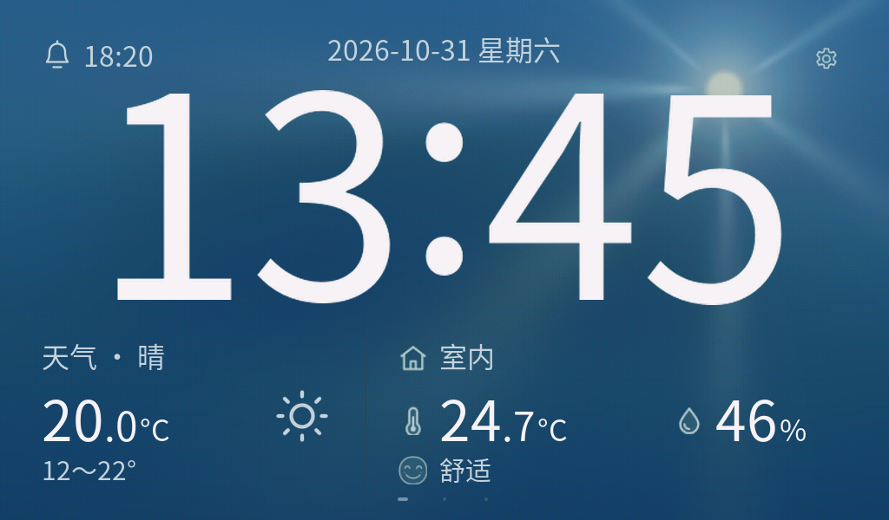
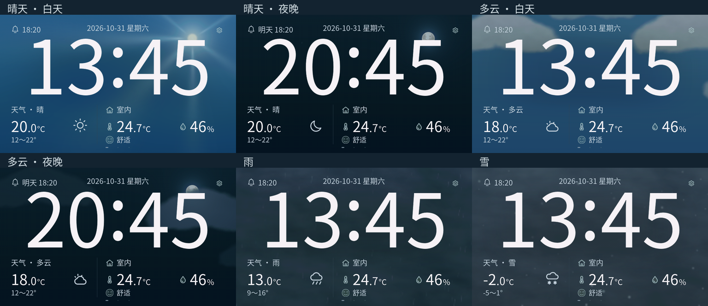
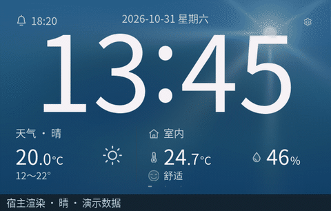
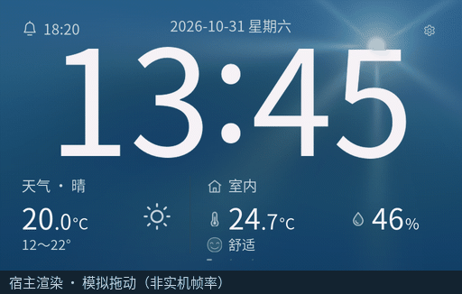
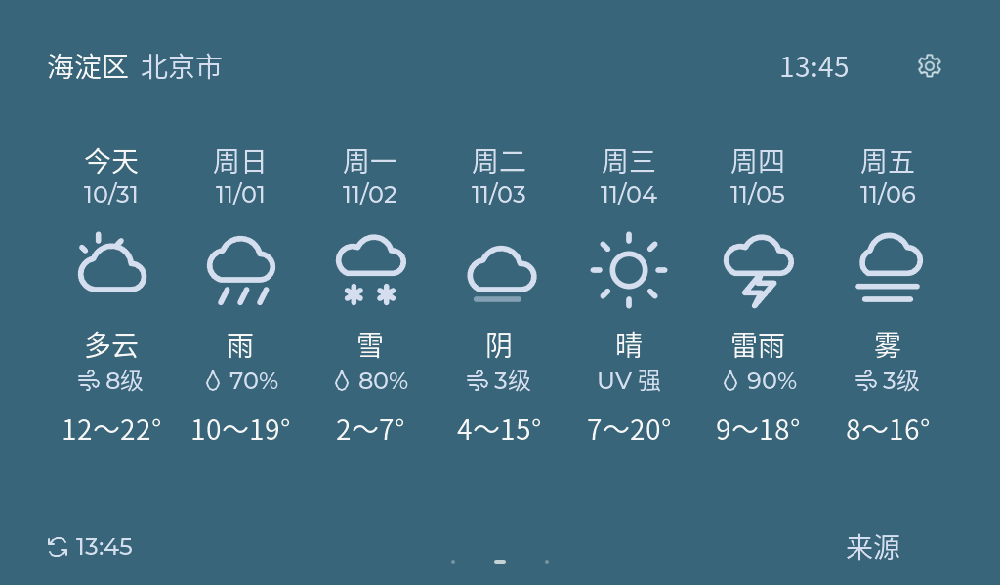
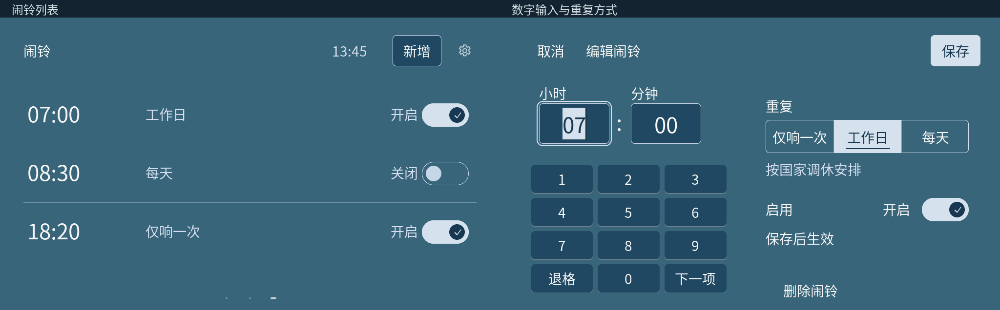

# Home Clock · 家庭时钟

面向客厅的七寸触屏时钟：大字时间、动态天气、室内温湿度和闹铃，随环境光自动调节亮度。

下列截图和动图均由当前固件的LVGL在电脑上渲染，使用公开合成数据；滑动为模拟触摸，非实机拍摄或实机帧率测评。

## 七项亮点

- **跟手循环翻页。** 时钟、七天天气和闹铃三个页面随手势左右移动，首尾相接。
- **按地点切换昼夜。** 晴天与多云背景随所选地点的日出、日落切换日景与月夜，无需手动设置。
- **当前天气动态背景。** 背景随天气变化，日间光线、云层与雨雪轻缓变化，户外夜间静止；天气未知或过期时回到中性背景。
- **懂调休的工作日闹铃。** 按中国大陆年度放假调休表，放假跳过、周末补班照常响；也支持仅响一次和每天，音量可调、温和渐强。缺少对应年份的表时提示并暂按周一至周五执行。
- **随环境光自动调亮度。** BH1750感知室内光线，低照度时改用黑底并停止天气动效，减少夜间干扰。
- **离线拼音地点联想。** 用汉字、全拼或简拼查找城市、区县，在本机选择地点；天气数据待联网后更新。
- **设备独立，本地优先。** 触屏完成Wi-Fi和地点配置，无需手机、账号或家庭服务器。设置保存在本机，全家共用一套；持续供电且已校时后，断网仍能走时、读取传感器和执行本地闹铃。

## 界面与动效

**天气与昼夜**

晴天与多云各有日景和月夜。阴、雨、雪在日落后沿用原背景，只有室内低照度才切换黑底显示。

日间云层、光线与雨雪缓慢变化。

**跟手翻页**

**七天概览**

天气形态、温度范围和逐日重点提示一屏查看。

**闹铃列表与数字编辑**

直接点选小时、分钟输入数字，设置重复方式；主页显示下一次实际响铃时间。

## 硬件与环境

| 项目 | 已验证配置 |
| --- | --- |
| 主板 | 微雪ESP32-P4-WIFI6-Touch-LCD-7B，PCB Rev1.1，P4 v3.2，32MB Flash |
| 显示与音频 | 1024×600触屏，板载音频与配套扬声器 |
| 传感器 | SHT40/SHT4X模块、BH1750 GY-302模块，共用板载I²C |
| 框架 | ESP-IDF 6.1、LVGL 9.6.0、LVGL adapter 0.7.3 |
| 构建环境 | Windows、PowerShell 7、已导出的ESP-IDF环境 |

接线见[硬件说明](docs/hardware.md)，固定依赖与工具链见[构建说明](docs/building.md)。其他板型、芯片修订或C6从机固件未作兼容承诺。

## 开始使用

第一版已在实物上完成日常使用测试。本仓库提供源码、固定依赖与构建说明，当前不提供预编译固件。

1. 按[快速开始](docs/getting-started.md)检查硬件和环境。
2. 按[构建说明](docs/building.md)生成正式固件；构建与烧录分别执行。
3. 首次开机在触屏配置Wi-Fi，联网自动校时后设置天气位置和闹铃。

不配置电池。断电期间不能走时或响铃；来电后读取配置并重新联网校时，错过的闹铃不补响。

天气主源是Open-Meteo；提供自己的联系信息后，可启用MET Norway作为当前天气备用源。七日预报继续使用主源与有效缓存。接口数据是所选地点的参考天气，不是家门口实测。

## 更多文档

- [文档导航](docs/README.md)
- [使用说明](docs/usage.md)
- [架构与模块](docs/architecture.md)
- [贡献约定](CONTRIBUTING.md)
- [第三方来源与许可](THIRD_PARTY_NOTICES.md)

## 许可

项目自有代码、原创音源和原创程序图形采用[MIT](LICENSE)。第三方板级组件、字体、图标、地点与节假日数据分别保留原协议，见[第三方清单](THIRD_PARTY_NOTICES.md)。项目许可不替代在线天气服务的使用条款。
